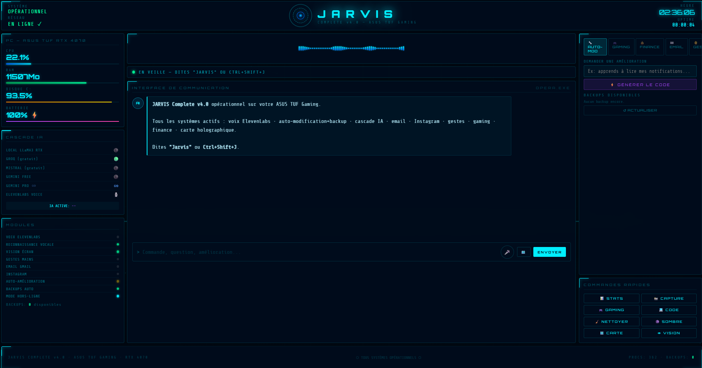
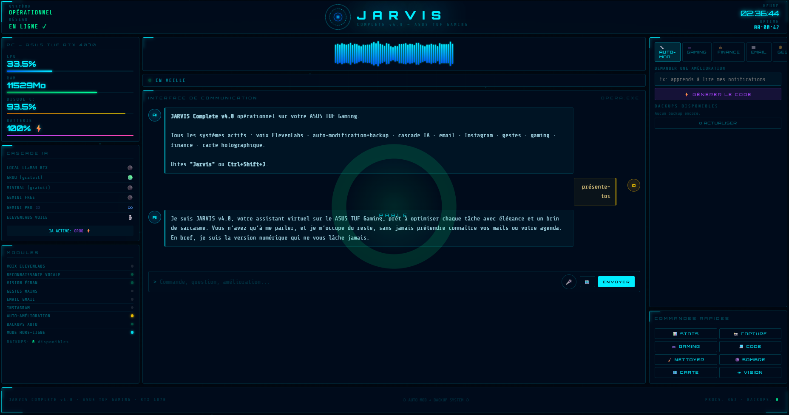
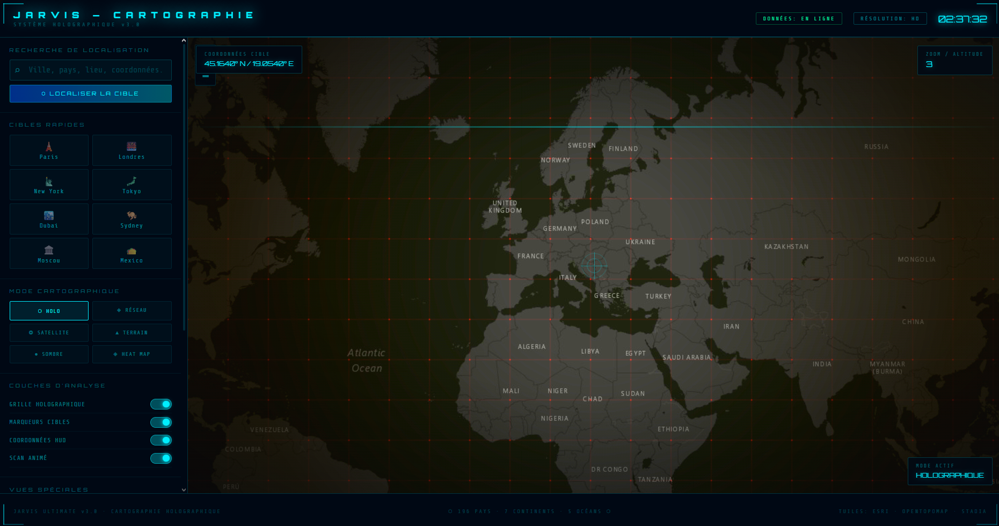

# JARVIS — Personal AI Voice Assistant

A Python voice assistant that runs on my Windows laptop (ASUS TUF Gaming A15), with an Iron Man-style web interface, and that I can also talk to from my iPhone.

> Personal project by Amine Jebali — Computer Science student (BUT Informatique, IUT de Bordeaux, France).



## Screenshots

| Conversation | Holographic map |
|---|---|
|  |  |

## Features

| Area | What JARVIS does |
|---|---|
| 🎙️ Voice | Wake word "Jarvis" or `Ctrl+Shift+J`, Google speech recognition, ElevenLabs voice replies |
| 🧠 AI | Multi-LLM fallback: Groq (`openai/gpt-oss-120b`) → Mistral → Gemini → local Ollama |
| ☀️ Morning briefing | Today's classes, reminders, upcoming exams, unread emails, tasks from my Obsidian projects, science/tech news and football news |
| 📅 Calendar | Reads my university timetable (HyperPlanning `.ics`); creates, moves and deletes events in my iPhone Calendar (iCloud / CalDAV) |
| 📚 Exams | "What's my next exam?" → subject name in plain words (not the course code), date, time, room |
| 📝 Reminders | "Add a reminder on Monday to…" → written to `Rappels.md` in my Obsidian vault |
| 📧 Email | Reads IMAP mailboxes (university Zimbra, Gmail…) without marking emails as read |
| 📓 Obsidian | Reads my project notes to learn my interests; writes a daily news note |
| 📱 iPhone | Private server over Tailscale + secret token, with two iOS Shortcuts: "Jarvis" (talk) and "Morning briefing" |
| ✋ Gestures | Webcam control with MediaPipe GestureRecognizer: ✊ 🖐️ 👍 👎 ✌️ |
| 🗺️ Map | "Holographic" Leaflet map (Esri tiles, no API key) |
| 👁️ Vision | Screen and webcam analysis (optional, Anthropic API) |
| 🛠️ Self-improvement | Generates new Python functions on request, with automatic backups |
| 🚀 Startup | Launches automatically with Windows |

> JARVIS understands French: the voice commands below are the ones I actually use.

## Architecture

```
jarvis.py              core: config, voice, commands, web server (7474) and iPhone server (7475)
voice_engine.py        text-to-speech (ElevenLabs, pyttsx3 fallback)
news_matin.py          morning briefing + Obsidian vault reading + Google News RSS
briefing_extras.py     .ics calendar, exams, IMAP email, Obsidian tasks, home server status
rappels.py             reminders stored in Rappels.md (Obsidian)
calendrier_icloud.py   create / update / delete iCloud events (CalDAV)
self_mod.py            self-improvement (code generation with backups)
ui/index.html          web interface
ui/map.html            holographic map
LANCER_JARVIS.bat      launcher (waits for the network)
ACTIVER_DEMARRAGE_AUTO.bat / DESACTIVER_DEMARRAGE_AUTO.bat   enable / disable auto-start
```

## Installation

1. Install **Python 3.11** (tick "Add to PATH").
2. Clone the repository and create your config:
   ```bat
   git clone https://github.com/ukiyoaj/jarvis.git
   cd jarvis
   copy config.example.json config.json
   ```
3. Fill in `config.json` (API keys, calendar links, mailboxes…). **This file is never pushed to GitHub** (see `.gitignore`).
4. Run `LANCER_JARVIS.bat`. Missing Python packages are installed automatically on first launch.
5. (Optional) Run `ACTIVER_DEMARRAGE_AUTO.bat` to start JARVIS with Windows.

### iPhone access
- Install **Tailscale** on the PC and the iPhone (same account).
- The secret `remote_token` is generated automatically in `config.json` on first launch.
- iOS Shortcuts call `http://<PC-Tailscale-IP>:7475/ask?token=<token>&q=<question>` and `/briefing.txt?token=<token>`.

## Example commands (in French)

| Command | Meaning |
|---|---|
| « news du jour » · « mes passions » | Today's news · my interests |
| « j'ai quoi comme cours lundi » · « j'ai quoi pour le 30 novembre » | My classes on Monday · what's on November 30 |
| « c'est quoi mon prochain DS » · « mes prochains DS » | My next exam · my next exams |
| « rajoute un rappel mardi de rendre le TP » · « mes rappels » · « c'est fait rendre le TP » | Add a reminder · list reminders · mark one as done |
| « ajoute à mon agenda révision maths mercredi à 14h pendant 2 heures » | Add an event to my iPhone calendar |
| « déplace la révision à jeudi 10h » · « supprime le dentiste de mon agenda » | Move · delete an event |
| « mon dernier mail » · « mes mails IUT » | Latest email · university inbox |
| « active les gestes » / « désactive les gestes » | Turn gesture control on / off |

## Security

- All secrets (API keys, app-specific passwords, iPhone token) live in `config.json`, which is ignored by Git.
- The iPhone server (port 7475) only accepts the Tailscale network and requires the secret token.
- iCloud and email use **app-specific passwords**, never the real account password.

## Roadmap

- Instagram replies through the official Meta API
- Run JARVIS 24/7 on my home server (Acer Nitro 5)
- Faster startup (lazy-load heavy modules)

## License

[MIT](LICENSE) © 2026 Amine Jebali
